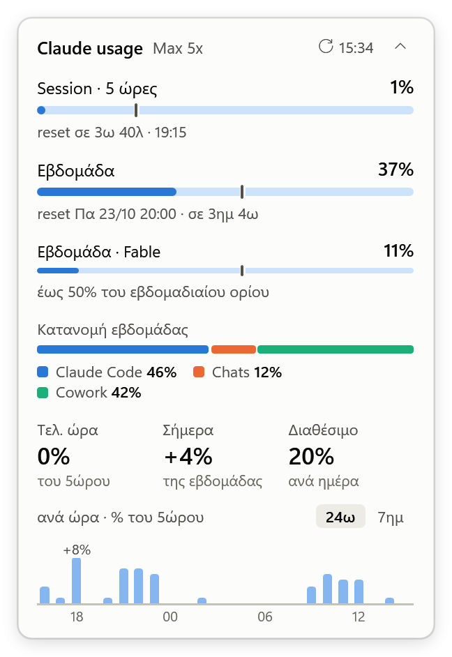
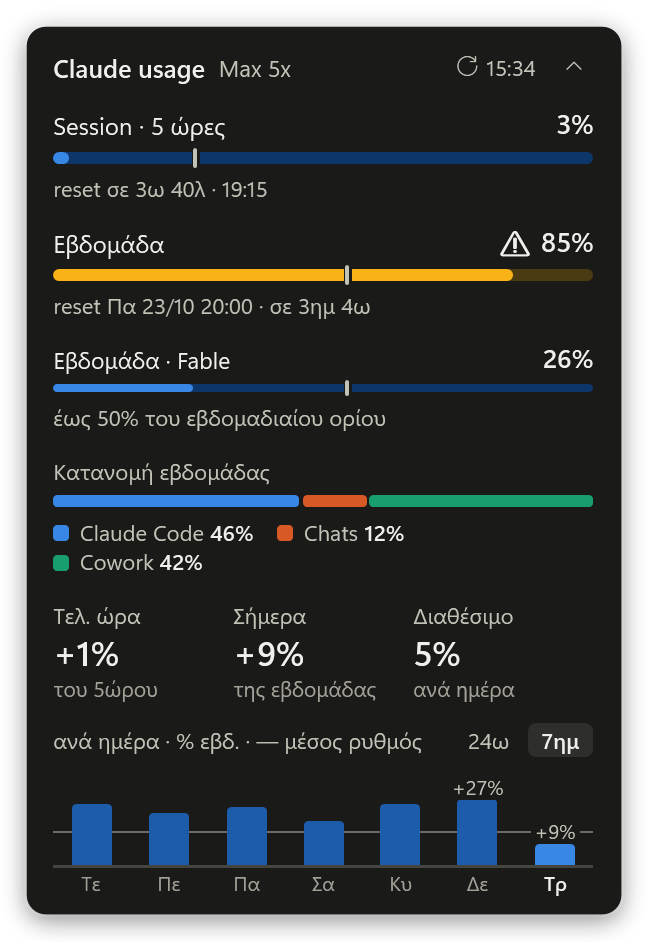
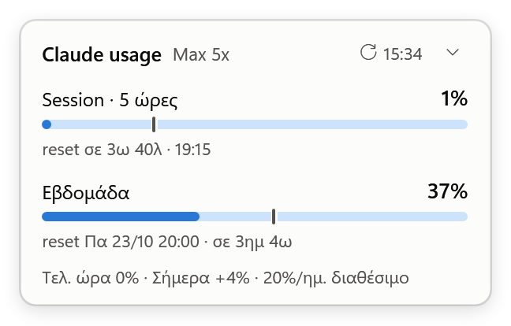

# claude-usage-widget

A small floating desktop widget for Windows 11 that shows Claude plan usage at a glance: the 5-hour session,
the weekly limit (plus per-model weekly limits such as Fable), how the week splits across Claude Code / Chats /
Cowork, and hourly / daily history. The UI is in Greek.

| Light (expanded) | Dark (high usage) | Compact |
|---|---|---|
|  |  |  |

*Screenshots use the built-in demo data (`-Demo`), not a real account.*

## What it shows

| Element | Meaning |
|---|---|
| **Session · 5 ώρες** | % of the current 5-hour session limit and the reset countdown. The vertical tick marks how much of the 5-hour window has passed. |
| **Εβδομάδα** | % of the weekly limit (all models) and the reset day/time. The tick marks where an even pace would be. |
| **Εβδομάδα · Fable** | A per-model weekly limit, only when the API reports one (with its share of the weekly limit). |
| **Κατανομή εβδομάδας** | Share of this week's usage per surface (Claude Code, Chats, Cowork, other). |
| **Τελ. ώρα** | Session % used in the last 60 minutes. |
| **Σήμερα** | Weekly % used since local midnight. |
| **Διαθέσιμο** | Weekly % still available per day until the weekly reset. |
| **24ω / 7ημ** chart | Session % per hour (last 24 h) or weekly % per day (last 7 days, with the 1/7 even-pace line). Hover a column for details. |

Bars turn amber with a ⚠ from 75 % and red from 90 % (or earlier if the API reports a warning severity).

## How it works

- Polls `GET https://api.anthropic.com/api/oauth/usage` every 5 minutes (the endpoint behind Claude Code's
  `/usage`), with exponential backoff on errors and `Retry-After` on HTTP 429.
- Auth: the Claude Code OAuth access token from `%USERPROFILE%\.claude\.credentials.json`
  (or `%CLAUDE_CONFIG_DIR%`), **read-only**. See [SECURITY.md](SECURITY.md).
- History: the API only returns current percentages, so the widget stores one sample per poll in `history.csv`
  (8 days kept) and derives the hourly and daily numbers from the increments; a window that reset between two
  samples counts from zero. History starts when the widget first runs. Usage while the PC was off is attributed to
  the next sample and marked as such in the tooltip.
- Footprint: built-in Windows PowerShell 5.1 + WPF, no modules. After start-up the widget trims its working set
  (about 20 MB) and only redraws every 20 seconds.
- The endpoint is undocumented and may change. The parser prefers the newer `limits` array and falls back to the
  older `five_hour` / `seven_day` / `seven_day_<model>` fields; unknown fields are ignored.

## Requirements

- Windows 10/11 with the built-in Windows PowerShell 5.1. No modules, no admin rights.
- Claude Code installed and signed in with a Claude subscription (Pro / Max / Team).

## Install / update

```powershell
git clone https://github.com/konzag/claude-usage-widget.git D:\Git\claude-usage-widget
cd D:\Git\claude-usage-widget
powershell -NoProfile -ExecutionPolicy Bypass -File .\install.ps1
```

Success check: every line says `PASS`, the last one `INSTALL OK`, and the widget appears bottom-right above the
taskbar. Options: `-NoAutostart` (do not start with Windows), `-NoStart`.

Update: `git pull`, then run `install.ps1` again (settings and history are kept).

## Use

- Drag anywhere to move; the position is remembered and anchored to the nearer screen edge, so the widget grows
  away from it.
- Chevron (or double-click): compact ↔ expanded.
- Click the time in the header: refresh now.
- Right-click: refresh, always on top, compact view, theme (auto / light / dark), start with Windows, reset
  position, open claude.ai/settings/usage, open the data folder, exit.
- Start it again from the Start Menu: **Claude Usage Widget**.

## When the token has expired

Claude Code's access token lives about 8 hours and only Claude Code refreshes it. When it has expired, the widget
keeps the last values (dimmed), shows a note, and resumes on its own as soon as the credentials file changes, which
happens on the next Claude Code use. The widget never refreshes or rewrites credentials: rotating the refresh token
outside Claude Code could sign Claude Code out.

## Files

| Path (`%LOCALAPPDATA%\ClaudeUsageWidget\`) | Content |
|---|---|
| `ClaudeUsageWidget.ps1`, `UsageCore.psm1` | installed program (copied from `src\`) |
| `settings.json` | position, view, chart tab, theme, `pollMinutes` (minimum 1) |
| `history.csv` | samples `ts,session,session_reset,week,week_reset` (UTC, UTF-8) |
| `last.json` | last API response (percentages and reset times only) |
| `widget.log` | start/stop, errors, state changes (never the token); rotates at 256 KB |

## Development

```powershell
# Logic tests, no dependencies (Windows PowerShell 5.1 and PowerShell 7)
powershell -NoProfile -File .\tests\run-tests.ps1     # expect: TESTS pass=N fail=0
pwsh -NoProfile -File .\tests\run-tests.ps1

# Render to PNG without touching history or settings
# Demo scenarios: normal, high, expired, offline, empty. Without -Demo it renders live data (read-only).
powershell -NoProfile -STA -File .\src\ClaudeUsageWidget.ps1 -Snapshot .\out\light.png -Demo normal -Theme light
powershell -NoProfile -STA -File .\src\ClaudeUsageWidget.ps1 -Snapshot .\out\dark.png -Demo high -Theme dark
powershell -NoProfile -STA -File .\src\ClaudeUsageWidget.ps1 -Snapshot .\out\days.png -Demo normal -Chart days
```

Layout: `src/UsageCore.psm1` holds all logic (parsing, history math, formatting) and is what the tests cover;
`src/ClaudeUsageWidget.ps1` is only the WPF window, polling and menu. See [CLAUDE.md](CLAUDE.md) for the rules.

## Uninstall / rollback

```powershell
powershell -NoProfile -ExecutionPolicy Bypass -File .\uninstall.ps1          # keeps settings and history
powershell -NoProfile -ExecutionPolicy Bypass -File .\uninstall.ps1 -Purge   # removes the data folder too
```

Success check: every line says `PASS`, the last one `UNINSTALL OK`. Claude Code's credentials are never touched.

## License

[MIT](LICENSE)
